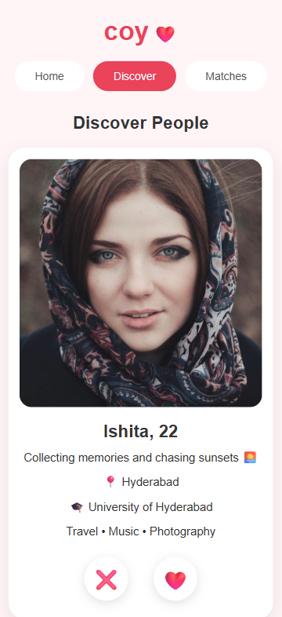
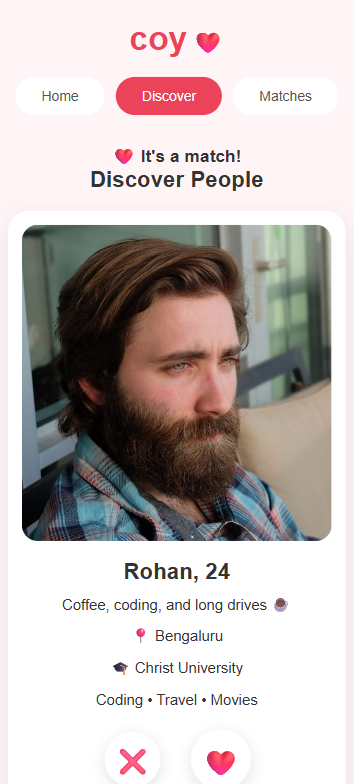
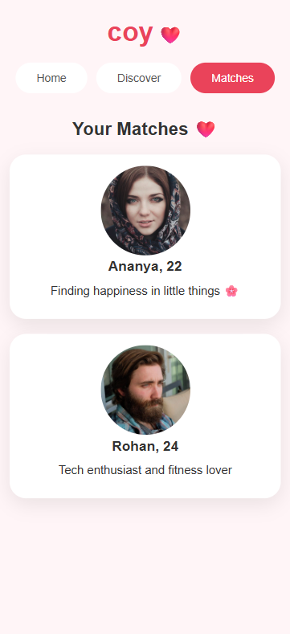
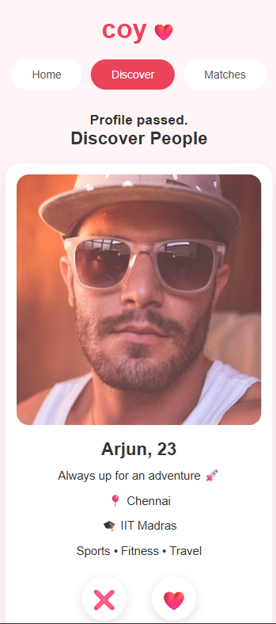

# Coy Discover – Swipe-Based Discovery App

A mobile-first profile discovery application inspired by Coy. Users can discover profiles, like or pass on them, and view mutual matches.

## Features

- **Profile Discovery:** Discover one profile at a time.
- **Swipe Interaction:** Swipe right to like and left to pass.
- **Desktop Controls:** Like and pass buttons for desktop users.
- **Swipe Animations:** Smooth card animations with visual feedback.
- **Persistent Swipes:** Profiles that have already been swiped on do not appear again.
- **Mutual Matching:** A match is created only when both users like each other.
- **Matches Page:** Displays only mutual matches.
- **Empty State:** Shows a friendly message when all available profiles have been discovered.
- **Database Persistence:** Profiles and swipe records are stored in MongoDB.

## Screenshots

### 1. Home Page

The Home tab is intentionally kept blank as required by the assignment.


### 2. Discover Page

Displays one profile at a time with profile details, interests, and like/pass actions.



### 3. Match Screen

Displays a match confirmation when two users like each other.



### 4. Matches Page

Displays profiles with mutual likes.



### 5. Empty State

Displayed when the user has discovered all available profiles.


### 6. Profile Pass

Demonstrates the profile pass interaction.



## Tech Stack

| Technology | Purpose |
|---|---|
| React.js | Frontend UI |
| Vite | Frontend development and build tool |
| CSS | Styling and animations |
| Node.js | Backend runtime |
| Express.js | REST API development |
| MongoDB Atlas | Database |
| Mongoose | MongoDB object modeling |

## Project Structure

```text
coy/
│
├── client/
│   ├── public/
│   ├── src/
│   │   ├── App.jsx
│   │   ├── App.css
│   │   └── main.jsx
│   └── package.json
│
├── server/
│   ├── models/
│   │   ├── Profile.js
│   │   └── Swipe.js
│   ├── .env
│   ├── server.js
│   ├── seed.js
│   ├── addProfiles.js
│   ├── addScreenshotProfiles.js
│   └── package.json
│
├── screenshots/
│   ├── caughtup.png
│   ├── discover.png
│   ├── Home.png
│   ├── match.png
│   ├── matches.png
│   └── profilepass.png
│
├── .gitignore
└── README.md
```

## Getting Started

### Prerequisites

- Node.js and npm
- MongoDB Atlas account
- Git

### 1. Clone the Repository

```bash
git clone https://github.com/Jyothichavakula/coy_proj.git

cd coy_proj
```

### 2. Set Up the Backend

Navigate to the server directory:

```bash
cd server
```

Install dependencies:

```bash
npm install
```

Create a `.env` file inside the `server` directory:

```env
MONGO_URI=your_mongodb_connection_string
PORT=5000
```

Replace the placeholder with your MongoDB Atlas connection string.

Start the backend:

```bash
npm run dev
```

The backend runs at:

`http://localhost:5000`

### 3. Set Up the Frontend

Open a second terminal and navigate to the client directory:

```bash
cd client
```

Install dependencies:

```bash
npm install
```

Start the frontend:

```bash
npm run dev
```

Open the local URL displayed by Vite in your browser.

## API Endpoints

| Method | Endpoint | Description |
|---|---|---|
| GET | `/feed` | Retrieves profiles that the current user has not swiped on |
| POST | `/swipe` | Records a like or pass action and checks for a mutual match |
| GET | `/matches` | Retrieves profiles with mutual likes |

### Swipe API Request Example

**POST** `/swipe`

Request body:

```json
{
  "targetId": "PROFILE_ID",
  "action": "like"
}
```

Supported actions:

- `like` – Likes the selected profile.
- `pass` – Passes on the selected profile.

The backend checks whether the selected profile has already liked the current user. A mutual match is returned only when both users have liked each other.

## Database Models

### Profile

Stores profile information:

- Name
- Age
- Bio
- Profile image
- City
- College
- Interests

### Swipe

Stores swipe activity:

- Swiper ID
- Target ID
- Action (like/pass)
- Created and updated timestamps

## Matching Logic

1. The user receives profiles through the Discover feed.
2. The user likes or passes on a profile.
3. The swipe action is saved in MongoDB.
4. If the user likes a profile, the backend checks whether that profile has already liked the current user.
5. If both users have liked each other, a mutual match is returned.
6. Only mutual matches are displayed on the Matches page.

## Important Notes

- The application uses mock profile data for demonstration.
- The current user is represented by a fixed ID: `current-user`.
- Incoming likes are not directly revealed to the user.
- Swipe history and match information persist in MongoDB.
- The `seed.js` script resets existing profile and swipe data. Use it only when you intentionally want to reset the demo database.
- Never commit your `.env` file or expose database credentials.

## Author

**Chavvakula Jyothi Sri**

B.Tech – Computer Science and Engineering (Artificial Intelligence and Data Science)

GitHub: [Jyothichavakula](https://github.com/Jyothichavakula)

## Repository

[View Coy Discover on GitHub](https://github.com/Jyothichavakula/coy_proj)
